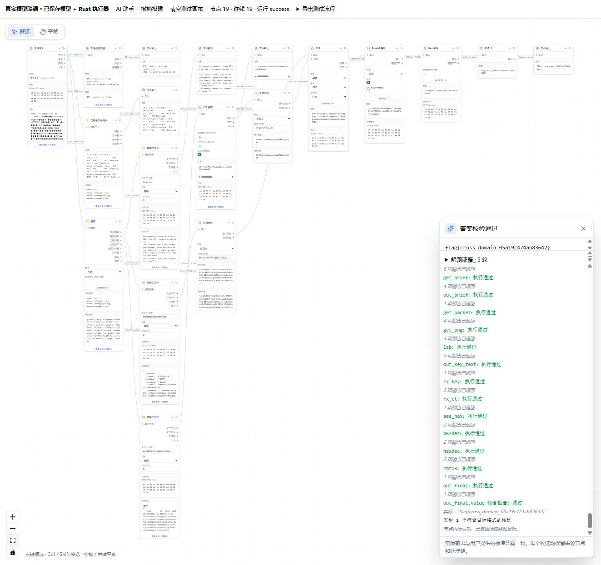
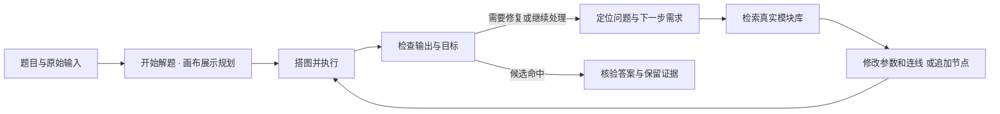

<div align="center">


# LovelyMiscLab

**把解题过程，变成可复跑的节点工作流。**

面向 CTF Misc、编码解密、隐写分析与文件取证的桌面工作台。<br />
手动搭图，也可以让 AI 根据真实结果查找模块、修改配置、继续拼接。


[快速开始](#快速开始) · [AI 自主解题](#ai-工作流助手) · [画布操作](#画布操作) · [节点分类](#节点分类) · [MCP](#mcp-与-ai-调用) · [开发](#开发)

</div>

---

> **v0.3.1 · 2026-10-27**
>
> 当前源码包含 **519 个内置节点、18 个一级分类、48 个二级分组**。自主解题一键启动，规划直接展示在画布；AI 网络重试与真实模块检索支持持续解题。
>
> EBCTFCodeBox 的 **820 项操作已验收 155 项**。稳定版 [v0.3.1 Release](https://github.com/LovelyTeams/LovelyMiscLab/releases/tag/v0.3.1) 提供 Windows、Linux、macOS 下载，包含 489 个节点、135 项已验收操作；发布后的第 14–18 批增量已进入源码。

## 这是什么

LovelyMiscLab 用节点和连线表达数据处理过程：导入一份文件或文本，选择处理模块，配置参数，再把输出连接到下一步。Rust 引擎按依赖顺序执行，画布显示结果预览，完整内容可以在侧栏或独立调用窗口中查看。

从一次 Base64 解码，到“识别压缩包 → 提取图片 → 隐写取密钥 → AES 解密 → 多层解码”，每一步都能检查、修改、重跑，并保存为 `.lml` 流程。

<p align="center">
  
  <br />
  <sub>真实模型联调记录：5 轮诊断与续接，最终 19 个节点、19 条连线，答案通过本地精确校验。</sub>
</p>

## 主要特性

| 能力 | 可以做什么 |
|---|---|
| **节点式工作流** | 类型化端口、参数驱动、实时结果预览；支持整图执行、运行到节点和增量重算。 |
| **统一模块库** | 按中英文名称、节点 ID、上游操作 ID、别名、说明和算法家族搜索；分类折叠、分段加载，模块页面每页 50 项。 |
| **AI 自主解题** | 点一次开始，画布直接展示判断、模块检索和节点计划，自动搭图执行；根据证据修改或继续拼接，再复测。 |
| **独立调用** | 把单个模块作为工具使用，支持文本、Hex/Base64、文件、数值、布尔、JSON、列表和图片等输入；结果保留在调用窗口。 |
| **文件产物** | 通过 `artifact_store` 保存产物，查询名称、大小、MIME 与 SHA-256；用 `artifact_read` 显式读回字节，继续处理或导出。 |
| **画布编辑** | 框选、多选、批量删除、剪切复制粘贴、撤销重做、重新连线和自动整理；兼容常见 Windows 快捷键。 |
| **MCP 接入** | 外部 AI 客户端可以发现模块、运行节点、读写画布和保存流程，与桌面工作区协作。 |
| **本地扩展** | 将子图封装为复合模块，或把本地脚本、外部程序接入为自定义节点。 |

内置分析与编解码由 Rust 引擎在本机执行。使用 AI 功能时，题目描述、文件路径及有界运行摘要会发送到你配置的模型服务；摘要可能包含题目内容和中间结果。联网节点、自定义脚本的行为由相应模块与配置决定。

## 快速开始

### 1. 启动桌面版

安装包与发布信息见 [本仓库 Releases](https://github.com/LovelyTeams/LovelyMiscLab/releases)。也可以从源码启动：

```bash
git clone https://github.com/LovelyTeams/LovelyMiscLab.git
cd LovelyMiscLab
pnpm install
pnpm tauri dev
```

源码运行需要 Node.js、pnpm、Rust 和 [Tauri 系统依赖](https://tauri.app/start/prerequisites/)，详见 [开发](#开发)。`pnpm dev` 仅打开浏览器前端预览；实际 Rust 节点执行和模型调用请使用桌面版。

### 2. 手动跑一条流程

1. 从模块库加入「文本输入」「Base64 解码」「文本输出」。
2. 在文本输入中填写 `SGVsbG8=`，将三个节点的文本端口依次连接。
3. 执行流程，检查最终输出是否为 `Hello`。
4. 按 `Ctrl+S` 保存为 `.lml`，以后可以重新打开、修改和复跑。

处理二进制文件时，使用文件导入节点的 **bytes 端口**连接后续模块；文本预览用于阅读，完整字节用于继续处理。

### 3. 让 AI 根据题目搭图

1. 在 **设置 → AI 模型 → 文本模型**中填写模型名、Base URL 和 API Key。
2. 点击右上角 **保存设置**，确认出现“设置已写入本机 · 时间”。
3. 打开 **AI 工作流助手 → 自主解题**，填写题目描述，并提供文本或选择题目文件。
4. 设置尝试轮数、总时限与追加/替换方式，点击一次 **开始解题**。
5. 在画布中直接查看当前判断、下一步、模块检索、节点计划和执行结果，无需再次确认或展开规划记录；需要中止时点击 **停止**。

以上一键开始与画布规划展示从 v0.3.1 起提供。需要逐项审核计划时，可使用 **规划流程** 模式。

模型配置使用 OpenAI 兼容接口。文本模型用于规划和诊断；视觉模型是单独配置的能力。

## AI 工作流助手

### 从“搭一次图”到持续解题

自主解题会先判断当前证据意味着什么，再到真实模块库检索所需能力。检索命中后，规划器获取对应模块的端口、参数和默认值，生成可执行的图；下一轮根据实际结果继续调整。



例如，一次解题过程中可以出现这样的动作：

- **“LSB 扫描结果与题目提示不符。”** 查找专用 LSB 提取模块，改为绿色通道、最低位和 MSB 位序，再检查提取结果。
- **“AES 的密钥输入不正确。”** 检索正则提取模块，从上游输出中提取密钥和密文字段，重新接入 AES 并执行复测。
- **“解密成功，但明文仍有编码包装。”** 查找 Base64、Hex、ROT13 等模块，继续连接到现有处理链。

后续轮次复用同一张图中的有效节点，记录实际参数变化、模块替换和连线调整；每轮修改可以撤销。修复对象包括节点选择、参数和连接方式，判断依据来自运行结果。

### 四种工作模式

| 模式 | 行为 |
|---|---|
| **自主解题** | 点击开始后，在本次设定范围内持续诊断、检索、修改、执行与复测，规划过程直接显示在画布。 |
| **规划流程** | 生成完整计划，确认后自动配置、搭图并执行该计划。 |
| **解释画布** | 解释当前流程的数据流、关键参数与可能的失败点。 |
| **规划修复** | 根据当前图和错误提出修复计划，审核确认后执行。 |

### 执行范围与结果判定

- 自主解题默认 **5 轮、8 分钟**，可设置为 **1–8 轮、1–15 分钟**；每轮最多 20 个节点，最多选择 8 个题目文件。
- 点击“开始解题”授权本次设定范围内的自动尝试。自动解题使用内置本地处理模块和本次选定输入，遇到无可用能力、重复计划或预算耗尽时保留记录并停止。总时限包含首次规划时间。
- **节点执行成功**、**结果断言通过**、**找到候选答案**分别记录。移除失败节点或得到非空输出，不会直接判定整题已解决。
- 可填写“标准答案（可选，仅本地验收，不交给模型）”。该字段用于实际输出的精确比较，不加入模型提示词；未填写时，符合前缀的结果显示为候选，仍需核验。
- 报告保留每轮观察、模块检索结果、实际修改、错误、复测结论和候选来源，可导出解题记录。
- 当前开发版对网络超时、临时 HTTP 错误和损坏的服务响应自动重试两次（默认等待 1 秒、3 秒；服务返回的等待秒数优先）。仍失败时，画布出现 **重试 AI 请求**，从失败的模型请求继续，已有图和证据保留；等待计入总时限，可随时停止。鉴权、配置及流程校验错误不会按网络故障反复重试。
- 模块检索支持中英文、空格/下划线、全角字符与算法参数组合，例如 `Base64 decode`、`AES CBC 解密`。Agent 先查看真实模块索引；任何所需能力未命中时，最多两次改写检索词或拆为已有模块组合。实际缺失的能力会说明缺口并保留当前流程。

自主解题从首次分析开始即可在画布报告中点击“停止”，立即结束等待并丢弃迟到计划；已完成的图和证据保留。普通规划模式可使用“停止规划”、关闭规划窗口或按 Esc 取消。模型服务端已接受的计算是否终止，由服务端决定。

### 复杂题实测与示例

**2026-10-27 的一次真实模型测试**只向 Agent 提供题目描述与未知格式附件，随机标准答案单独保留在本地。处理链覆盖：

```text
未知文件 → ZIP 识别与解压 → 图片绿色通道 LSB → 密钥提取
        → AES-CBC 解密 → Base64 解码 → Hex 解码 → ROT13 → 答案
```

5 轮内经历了分支替换、密钥输入修复和后续解码，最终形成 **19 个节点、19 条连线**。实际答案通过本地精确校验；导出图又经 Rust 执行器独立复跑，19 个节点全部成功。

| 示例 | 文件 | 用途 |
|---|---|---|
| 诊断、检索与持续拼接 | [流程](examples/ai-complex-solver.lml) · [附件](examples/ai-complex-solver.dat) · [完整记录](examples/ai-complex-solver-validation.json) | 查看复杂题如何跨轮修复并继续处理。 |
| 未知归档的逐轮分析 | [流程](examples/ai-autonomous-archive.lml) · [附件](examples/ai-autonomous-archive.dat) | 查看文件识别、归档内容分析和多层解码。 |
| 固定计划与结果断言 | [流程](examples/ai-complex-ctf.lml) · [预期结果](examples/ai-complex-ctf.expected.json) | 验证预先审核的复杂流程及输出条件。 |

打开示例 `.lml` 后，请在文件导入节点重新选择本机对应附件；示例中保存的绝对路径来自测试环境。不含 AI 节点的已保存流程可直接在本机复跑；重新生成计划，或运行含 `ai_judge` 等 AI 节点的流程，仍需配置模型。

这组记录验证了指定样例上的行为；其他题目的完成情况取决于已有模块、输入线索和模型输出。

## 画布操作

默认在空白处左键拖动框选节点。`Ctrl / Shift` 点击可追加或取消选择，`Ctrl` 拖动框选可追加一组节点。左上角可切换平移工具，也可以按住空格或使用中键拖动画布。

拖动端口建立连线，连接时校验类型；右键节点、连线或选区可打开操作菜单。普通处理节点展示最多 3 个常用参数，长密钥、多行配置及高级参数在侧栏编辑。

| 快捷键 | 操作 |
|---|---|
| `Ctrl+A` / `Esc` | 全选节点与连线 / 取消选择 |
| `Ctrl+C` / `Ctrl+X` / `Ctrl+V` | 复制 / 剪切 / 粘贴选中子图，保留内部连线与参数 |
| `Ctrl+D` | 创建选中子图的副本 |
| `Delete` / `Backspace` | 批量删除节点或连线，删除节点时同步移除关联连线 |
| `Ctrl+Z` / `Ctrl+Y` / `Ctrl+Shift+Z` | 撤销 / 重做 |
| `F2` | 重命名单个选中节点；Enter 确认、Esc 取消 |
| 方向键 / `Shift+方向键` | 移动选中节点 1 / 10 个画布单位 |
| `Home` / `Ctrl+0` / `Ctrl++` / `Ctrl+-` | 适应视图 / 100% / 放大 / 缩小 |
| `Ctrl+N` / `Ctrl+O` / `Ctrl+S` / `Ctrl+Shift+S` | 新建 / 打开 / 保存 / 另存为流程 |
| `Ctrl+K` | 打开命令面板 |

macOS 上可使用对应的 `Cmd` 组合键。文本框内保留正常文字编辑行为，弹窗或菜单打开时不会操作底层画布。一次拖动、连续编辑同一参数或长按方向键按一次撤销记录处理。

## 节点分类

目录由 Rust 注册表统一定义，模块侧栏、模块页面、搜索菜单、帮助、AI 与 MCP 共用。编码与解码通常使用独立节点，同方向的算法变体通过参数选择。

<details>
<summary><b>展开当前源码的 519 个内置节点分类概览</b></summary>

数量核对日期：2026-10-27。一级分类共 18 个，含用于本地扩展的「自定义」。

| 分类 | 数量 | 代表能力 |
|---|---:|---|
| 输入输出 | 9 | 文本、文件、图片输入输出；文件产物保存与读取 |
| 编码解码 | 132 | Base 家族（含 DXBase64）、传输编码、字符集、花式编码 |
| 文本与数据 | 32 | 文本处理、URL Query/Cookie、JSON ↔ Base64url、Data URI、Rison |
| 进制与数值 | 136 | 进制、位与字节、Varint、数论、时间日期、地址与单位、UUID/ObjectID、UNIX 权限、地理编码、海明码、颜色互转与分析、素性检验与候选生成 |
| 古典密码 | 21 | ROT、凯撒、仿射、Playfair、Polybius、栅栏、Enigma |
| 现代密码 | 14 | AES、DES、Blowfish、RC4、ChaCha、Salsa、RSA、PGP、HMAC |
| 哈希与校验 | 14 | MD5、SHA、SHA3、RIPEMD、BLAKE2、SM3、CRC、bcrypt |
| 分析与破解 | 18 | 熵、字频、字节分布统计、自动识别、古典密码分析、口令与归档破解 |
| 压缩与归档 | 12 | Zlib、ZIP、7z、TAR、GZIP、RAR、Huffman；归档创建与修复 |
| 文件与取证 | 25 | 文件结构、Office/APK、ELF/PE/Mach-O、文件雕刻 |
| 隐写与水印 | 37 | 零宽字符、StegCloak、SNOW、图像与音频隐写、文件载体 |
| 图像与二维码 | 38 | 通道、滤镜、几何与色彩、FFT、GIF、宽高修复、二维码 |
| 音频与视频 | 3 | WAV 信息、频谱图、DTMF |
| 语言与执行 | 1 | Brainfuck |
| 可视化分析 | 3 | 字节直方图、熵曲线、字节分布图 |
| 控制与逻辑 | 22 | 开关、分支、门控、列表、映射、归约、比较与路由 |
| AI | 2 | 文本判断 `ai_judge`、视觉识图 `ai_vision` |
| 自定义 | 0 | 用户本地复合模块与脚本节点，数量随本地扩展变化 |

</details>

## MCP 与 AI 调用

应用内嵌基于 **rmcp + axum** 的 Streamable HTTP MCP 服务，默认关闭。可在 **设置 → MCP 服务**中启用，复制面板提供的端点、令牌和客户端配置。

默认端点为 `http://127.0.0.1:8765/mcp`，请求使用 `Authorization: Bearer <令牌>`。外部客户端通常先发现分类与模块，再读取具体签名，最后执行或编辑画布。

| 场景 | 工具 |
|---|---|
| 查找能力 | `list_categories` → `list_nodes` → `describe_node`；本地扩展使用 `list_modules` |
| 执行 | `run_node`、`run_graph`；整图执行可使用当前画布 |
| 编辑画布 | `get_canvas`、`set_canvas`、`add_node`、`connect`、`set_param`、`remove_node`、`remove_edge`、`move_node` |
| 保存与复用 | `save_workflow`、`load_workflow`、`save_composite_module` |
| 规划与环境 | `generate_workflow`、`get_settings`（配置脱敏）、`detect_tool`、`ping` |

内置 AI 工作流助手直接使用桌面配置的模型，无需启用 MCP。MCP 面向外部客户端；服务启用后，持有令牌的客户端可调用引擎和画布能力，其调用确认由相应客户端管理。

## EBCTFCodeBox 迁移进度

迁移基线固定为 [EBCTFCodeBox · ea2bc36](https://github.com/Henglie/EBCTFCodeBox/tree/ea2bc36dae31c97060f7f2cddad8df5519afad7b)，共 **820 项操作**。内置算法按实际功能用 Rust 实现，保留来源、参数映射、测试与兼容差异。

**v0.3.1 已发布，迁移已恢复。第 18 批新增 1 项操作、1 个节点，仍按每批最多 20 项验收。** 截至 2026-10-27 的源码进度：

| 状态 | 数量 | 含义 |
|---|---:|---|
| 已验收 | 155 | 有真实节点或参数组合映射，并完成相应测试 |
| 现有候选待核验 | 49 | 已找到可能对应的能力，尚未完成兼容验收 |
| 待迁入 | 616 | 后续批次需要实现或确认覆盖方式 |

**519 个节点不等于 519 项上游操作已迁移。** 一个操作可能拆成多个方向节点，也可能由某个节点的参数模式覆盖；名称相似不计完成。当前自主解题闭环的实测，也不代表上游所有“一把梭”或组合分析能力已完成迁移。

[迁移说明](docs/ebctf-migration.md) · [完整操作清单](docs/ebctf-operations.md) · [机器可读清单](docs/ebctf-migration.json) · [人工验收记录](docs/ebctf-acceptance.json)

## 下载 / 安装

发布工作流提供以下目标，实际可用资产以 [Release 页面](https://github.com/LovelyTeams/LovelyMiscLab/releases)为准：

| 平台 | 资源命名 | 运行要求 |
|---|---|---|
| Windows x64 | `LovelyMiscLab-<版本>-windows-x64.exe` | Windows 桌面环境与 WebView2 Runtime |
| Linux x64 | `LovelyMiscLab-<版本>-linux-x64` | 设置可执行权限，并准备 WebKitGTK 4.1 等运行依赖 |
| macOS Universal | `LovelyMiscLab-<版本>-macos-universal.dmg` | Intel / Apple Silicon；打开 DMG 后放入应用程序目录 |

从 v0.3.0 起，内置更新器使用 [LovelyTeams/LovelyMiscLab 发布渠道](https://github.com/LovelyTeams/LovelyMiscLab/releases)。旧版仍使用历史更新地址，可从本仓库 Release 页面下载新版。

## 开发

### 环境与启动

当前 CI 使用 **Node.js 22、pnpm 10、Rust 1.93.0**，并在 Windows、Linux、macOS 上执行构建与测试。操作系统依赖见 [Tauri 前置要求](https://tauri.app/start/prerequisites/)。

```bash
pnpm install --frozen-lockfile
pnpm tauri dev                 # 桌面开发：前端 + Rust 后端
```

```bash
pnpm dev                       # 仅浏览器前端预览
pnpm build                     # TypeScript 检查与前端生产构建
pnpm tauri build               # 构建桌面发布产物
```

Windows 的常规本地发布构建位于 `target/release/misclab-app.exe`。临时联调 EXE 不随源码分发；新环境可以通过桌面开发命令测试当前代码。

### 验证与目录维护

```bash
pnpm test:frontend             # 画布、计划、执行协调与自主解题回归
pnpm check:utf8                # UTF-8 检查
pnpm check:catalog             # Rust 注册表与前端生成目录一致性
pnpm build

cargo test -p misclab-core
cargo test -p misclab-app --features mcp
cargo clippy --workspace --all-targets -- -D warnings
```

修改 descriptor 后运行 `pnpm generate:catalog`，更新节点与分类目录。迁移人工状态维护在 `docs/ebctf-acceptance.json`；`pnpm generate:migration` 只更新派生清单，不覆盖人工验收结论。

格式化新增或修改的 Rust 文件；当前工作区的既有全仓库格式差异单独追踪。`misclab-core` 可脱离 Tauri 独立测试；MCP 通过 Cargo 的 `mcp` feature 门控，默认编译，但服务运行时默认关闭。

**最近一轮验证快照（2026-10-27）：** 61 项前端测试、30 项应用与 MCP 测试通过，严格 Clippy、UTF-8 和生产构建通过；复杂题完成真实模型联调与无模型参与的 Rust 独立复跑。记录见 [复杂题验收文件](examples/ai-complex-solver-validation.json)。常规回归测试不调用外部模型，真实模型联调需显式启用并使用本机已保存配置。

## 架构

```text
LovelyMiscLab/
├── crates/misclab-core/       # Rust 分析引擎
│   └── src/
│       ├── graph/            # 类型化数据流、执行器、缓存、复合模块
│       ├── node/             # descriptor、统一分类与注册表
│       └── nodes/            # 内置模块实现
├── src-tauri/                # 桌面应用外壳
│   └── src/
│       ├── commands/         # 图执行、模型决策、计划生成、产物与设置
│       └── mcp/              # MCP 工具、鉴权与画布桥接
├── src/
│   ├── flow/                 # 画布、参数与结果组件、Agent 规划和执行
│   ├── app/                  # AI 对话框、执行报告与桌面交互
│   ├── views/                # 模块、模板与设置等页面
│   ├── store/                # 图、运行、Agent 等状态
│   └── lib/                 # IPC 绑定、共享搜索与项目存取
├── examples/                 # 可复跑的流程、题目附件与验证记录
├── tests/                    # 前端回归与显式启用的真实模型联调
└── docs/                     # 迁移清单与验收记录
```

`NodeDescriptor` 统一声明输入、输出、参数、分类和展示信息。前端据此渲染模块、校验连线；AI 与 MCP 复用真实注册表和 Rust 执行器。

前端使用 **React 19、TypeScript、Vite 7、Tailwind CSS 4、React Flow、Zustand**；桌面外壳使用 **Tauri 2**，核心为 **Rust 2021**。

## 贡献

欢迎补充节点、修复问题、完善测试与文档。新增内置算法使用 Rust 与 Rust crate 实现；本地脚本节点是用户扩展能力，迁移时不将 Python、JavaScript、WASM 或外部程序引入为新增内置算法的运行依赖。

新增模块应提供明确的输入输出、参数说明、有效默认值、可运行示例和对照测试，并保留既有节点 ID、端口及参数的兼容性。完整要求见 [CONTRIBUTING.md](CONTRIBUTING.md)。

交流 QQ 群：**424875687**。

## 许可

LovelyMiscLab 使用 [GPL-3.0-only](LICENSE)。变更记录见 [CHANGELOG.md](CHANGELOG.md)。

感谢 [EBCTFCodeBox](https://github.com/Henglie/EBCTFCodeBox) 提供功能参考；迁移基线记录的上游许可为 Apache-2.0，具体来源与兼容差异保留在迁移文档和验收清单中。
